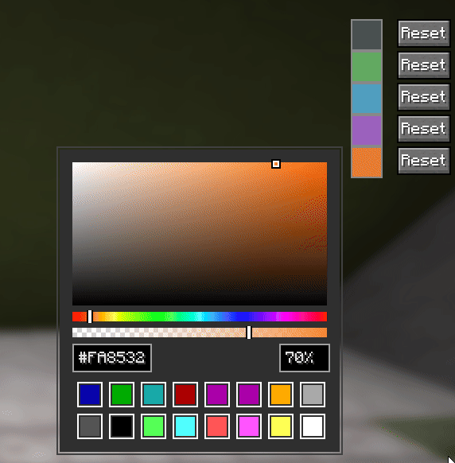

# CYT Utils

This is an unofficial mod for Fabric 26.2+ that provides QOL Changes to help improve their experience on CraftYourTown

# Features

Here are all the features that CYT Utils has to offer.

- Reverts 2D Player Heads in Server Pack
- Adds Item Highlighter which will lets you easily spot items in a Chest or Player vault
- Adds option to revert back to legacy fish textures

# Ideas for stuff to ad

- Tool Drop Prevention (Armour, Tools, Fishing Rods, Bows, Maces, etc)
- //calc replacement
- Ancient Coin Cost Estimate
- autofisher (joke)
- auto-react (joke x2)
- i don't know girl give me ideas, i like making mods (kind of)
## Mod Preview

| Colour Selector                                    |
|----------------------------------------------------|
|  |
